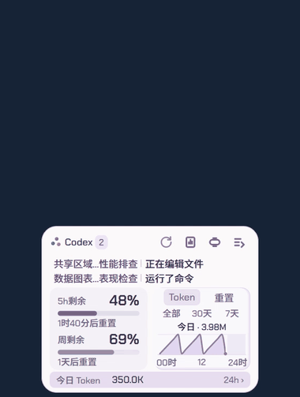
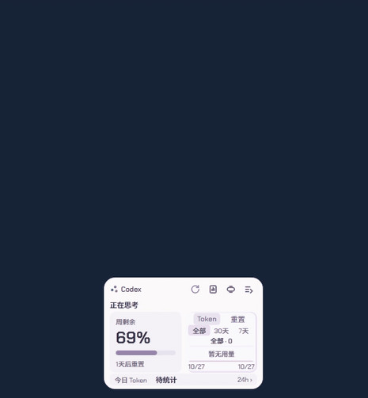
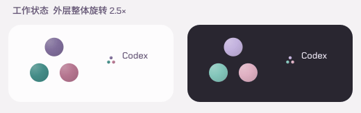
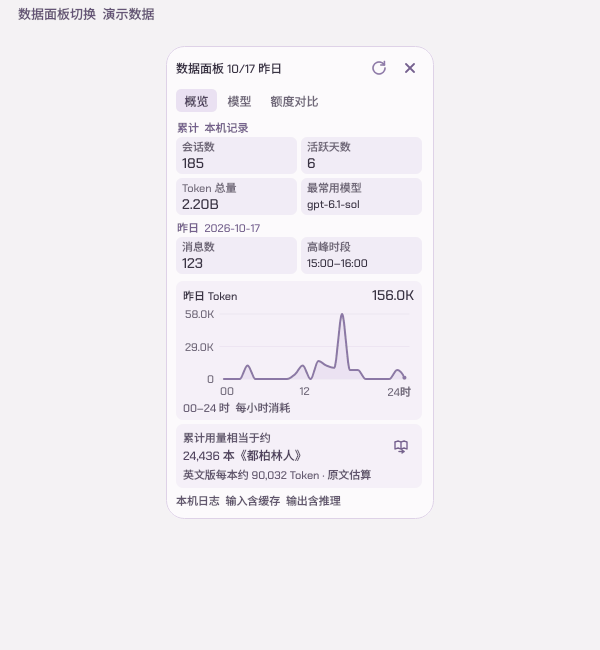

# Codex&GPT桌宠数据中心 | 你桌面的龙娘小助手

## 直接让 Agent 帮你使用

先阅读本项目 [INSTALL.md](INSTALL.md)，再按需下载、核验与运行。

```text
下载并运行 https://github.com/strive822/zyd-vibe-lab 里的 codex-bailong-desktop-pet。
请先读取该项目 INSTALL.md，下载完整文件并核验，在新目录准备项目内 Python 环境和已验证的官方播放素材，然后启动并检查；保留已有文件与账号，不全局安装、不代填密钥、不自动开启自启动。
```

本目录是基于上游 v1.2.1 的个人多平台改造，已于2026-10-30获终审确认并更新运行版。验证与回滚见 [升级审阅说明](docs/upgrade-review-1.2.1.md)。新增 GLM 订阅、DeepSeek 余额与用量、WorkBuddy 积分、Antigravity 云端额度（原应用关闭也可刷新）与实际响应 Token；按平台切换图表，模型页汇总实际用过的模型。中间及右侧胶囊改为悬浮展开，已保存账号的表单默认收起，移除聊天入口和“说明”标签，系统通知默认关闭（由 Codex 自己通知）。数据范围、未提供项与验证结果见 [多平台说明](docs/多平台账号说明.md)。下面保留上游介绍与历史记录，其中旧版聊天与点击胶囊描述不适用于本地扩展。


一只陪你使用 Codex 的 Windows 白龙桌宠：在桌面查看任务状态、接收完成提醒、追踪账户额度和 Token 用量。基于 [jingh12312-rgb/bailong-desktop-pet](https://github.com/jingh12312-rgb/bailong-desktop-pet) 持续改造，当前公开版本 **v1.2.1**。

**[首次安装：程序安装器 1.1.0](https://github.com/Wunsch2048/codex-bailong-desktop-pet/releases/tag/v1.1.0)** | [程序更新包](https://github.com/Wunsch2048/codex-bailong-desktop-pet/releases/latest) | [快速部署](docs/快速部署说明.txt) | [全部新增功能](docs/新增功能说明.txt) | [开发说明](docs/DEVELOPMENT.md) | [迭代历史](docs/迭代历史.txt)

安装器不含人物动画，新用户先获得卡片程序，可在设置中下载；已有素材和设置保留。

## 社区版本

| 平台 | 入口与维护者 | 当前说明的支持范围 |
| --- | --- | --- |
| Linux / Niri / KDE | [helantianshen 的社区仓库](https://github.com/helantianshen/codex-bailong-desktop-pet#linux--niri--kde) | niri 原生 Wayland 预览版；KDE Plasma X11 / XWayland 源码支持，限制见作者说明 |
| macOS / Apple Silicon | [Kki1ds 的社区预览包](https://github.com/Kki1ds/codex-bailong-desktop-pet/releases/tag/v1.0.1-mac.1) | 仅 Apple Silicon 的 DMG 预览包；未公证，无应用内更新，支持范围与限制见作者说明 |

社区版本由对应作者独立维护、测试和发布，安装说明与平台问题反馈请前往对应仓库。主仓库发布的安装包和更新补丁适用于 Windows x64。

### v1.2.1 程序补丁

- 改善远控或屏幕缩放恢复后的角色清晰度，避免放大后仍使用低分辨率动画帧。
- 顶栏按钮和托盘额度使用自定义悬停气泡，延迟显示、不抢焦点，数据面板不会遮挡按钮提示。
- 正常卡片与详情中的共有模块连续移动，保留图表进度；修复多会话文字在过渡途中消失。
- 减少重复快照绘制和隐藏页面的布局准备，保留原有防闪烁交接与高清素材。
- 升级后的自启与 Codex 联动入口使用标准 Windows 快捷方式。旧安装器未更新，杀软反馈仍需进一步核实。

[下载累计程序补丁 1.2.1](https://github.com/Wunsch2048/codex-bailong-desktop-pet/releases/tag/v1.2.1) | [完整更新说明](docs/releases/v1.2.1.md)

已有用户可在软件内更新，只需最新一份累计程序补丁，不重传动画。首次安装继续使用顶部有效的 1.1.0 安装器，安装后更新程序。



动图使用隔离合成数据，不作为屏幕帧率证明。

### v1.2.0 程序补丁（历史）

- 新增可自定义的额度涨跌提醒，默认下降 10%、上涨 15%；周额度角标显示实际变化。
- 修复程序目录迁移就绪回执不一致，以及重启后误拆额度周期、观察量和推测总量重新开始。
- 托盘使用无数字额度环，升级继承常驻选择；可选同屏游戏或视频全屏时只留托盘。
- 改善正常卡片与大卡片的首帧交接，Windows 设置历史托盘列表仍可能缓存残留。

[下载累计程序补丁 1.2.0](https://github.com/Wunsch2048/codex-bailong-desktop-pet/releases/tag/v1.2.0) | [完整更新说明](docs/releases/v1.2.0.md)

已有用户可直接在软件内更新；首次安装继续使用页面顶部的 1.1.0 安装器，安装后更新。不重复下载动画素材。



动图使用隔离演示数据，不作为屏幕帧率证明。

### v1.1.1 程序补丁（历史）

- 修复长时间未打开后展开卡片、数据面板和胶囊展开正常卡片时的提前露帧。
- 修复自动台词和点击台词被会话状态覆盖，并保留未读完成提醒。
- 这是累计程序补丁，不含动画素材。

[查看 v1.1.1 发布说明](docs/releases/v1.1.1.md)

### v1.1.0 程序补丁

- 首次安装可选程序目录，已有程序和已下载动画可分别迁移，升级与启动入口沿用新位置。
- 修复重启后日志恢复误报“记录受限”、画质配置结构异常导致启动失败，以及孤立额度回升导致整轮暂停估算。
- 改善久未打开卡片及内部切页时的跳闪，工作三球的最外层旋转调整为 2.5 倍，内部动作节拍不变。

这是累计程序补丁，只需最新一份，无需逐个安装旧补丁；已有有效动画继续复用。详见[完整更新说明](docs/releases/v1.1.0.md)。

| 工作状态动效 | 数据面板切换 |
| --- | --- |
|  |  |

动图为原生矢量合成时间及隔离窗口演示，不作为屏幕帧率证明。

### v1.0.1 程序补丁（历史）

- 额度对比按用量、总量变化和历史图分区，区分 5 个百分点估算门槛与 20 个百分点对比条件，完整规则按需展开。
- 新增 [WSL Codex 接入](docs/WSL.md)，支持 Linux 日志、Token 与 CLI 额度查询；真实 WSL 实机验证仍待反馈。
- 补齐程序与动画补丁的独立更新流程，修复额度对比切回概览时面板变短。

[该历史版更新说明](docs/releases/v1.0.1.md)。当前安装请使用页面顶部的最新入口。


### v1.0.0 更新

- 加入历史额度周期对比，显示周期已用 Token 与按剩余额度推测的总量，并区分套餐切换和数据不足。
- 桌宠自主移动衔接落地动画，水平范围可到屏幕两侧，减少在中间停留。
- 优化设置控件、数据面板导航与窗口过渡，改善按钮描边和展开闪烁。
- 支持仅安装卡片；动画可单独下载、启用或移除。
- 提供完整 Windows 安装包、应用内程序更新包、仅卡片安装包和独立轻量动画资源。

完整变化与安装方式见 [v1.0.0 更新说明](docs/releases/v1.0.0.md)。主仓库提供 Windows x64 版本；Linux 社区版和 macOS 移植信息见上方入口。
## 桌面上可以做什么

| 功能 | 实际表现 |
| --- | --- |
| Codex 实时状态 | 思考、编辑文件、运行命令、等待输入或审批、压缩上下文及完成；最多同时显示两个会话，更多会话轮换展示 |
| 不容易错过的完成提醒 | 完成后感叹号轻晃，再静止保留；点击确认或在 Codex 实际查看回复后消除；子会话不会重复冒充主会话提醒 |
| 会话跳转 | 点击气泡里的会话名，直接进入对应 Codex 对话 |
| 胶囊与卡片 | 闲置自动缩小，也可保持小胶囊；点击展开正常卡片，详情、聊天和设置集成在面板内 |
| 仅卡片安装 | 可不下载人物动画；之后可单独下载轻量或高清素材，也可移除动画保留卡片 |
| 额度与重置 | 真实账户提供的 5 小时和周剩余额度、重置倒计时；胶囊显示一个开口弧额度圆 |
| Token 统计 | 全部、30 天、7 天柱状图；点击今日 Token 查看 24 小时曲线 |
| 独立日报 | 累计与昨日指标分组、昨日小时曲线、按模型筛选；27 本书的等量比较使用累计 Token 与真实文本计数估算 |
| 额外重置公告 | 接入 Codex Resets 公告；网站公告与账户实际重置分别显示 |
| 龙娘互动 | 25 段动作，含新增五段工作和五段互动；工作动作持续跟随稳定的 Codex 状态并自然收尾，自动动作静音 |
| 全屏让位 | 可选视频让位，或同屏游戏/视频全屏时只留托盘；后者不会因完成提醒抢回显示，离开全屏恢复原偏好 |
| 应用内更新 | 设置 → 维护 → 软件更新；自动只检查，手动下载安装，支持暂停续传与SHA-256校验 |
| 日常使用 | 登录自启、托盘找回、连接诊断、自定义角色、集成闲聊、一键安装升级与回退 |

### 实际界面与动效

| 胶囊展开正常面板 | 日报展开与收回 |
| --- | --- |
|  |  |

历史变化见[迭代历史](docs/迭代历史.txt)和[版本记录](docs/releases)。其中旧版包名与界面属于当时版本，安装请使用页面顶部的当前公开版本入口。

## 安装与首次连接

1. 从 [v1.1.0 发布页](https://github.com/Wunsch2048/codex-bailong-desktop-pet/releases/tag/v1.1.0) 下载 `windows-x64.zip` 程序安装器，完整解压后运行其中的“一键部署.exe”；安装后在软件内更新到最新版本。
2. 安装器为当前 Windows 用户安装、校验并启动，无需 Python 或管理员权限。
3. 在本机安装并登录 Codex，发送一次消息。桌宠会自动发现本机数据，通常不需要重启 Codex。
4. 若没有数据，在“设置 → Codex → 检测连接与额度”检查各项能力；支持手动指定连接路径。

适用 **Windows x64**。新电脑必须使用自己的 Codex 登录；闲聊需要自行配置模型服务和密钥。新安装默认开启登录自启，可在设置关闭；升级保留原偏好。

安装目录：`%LOCALAPPDATA%\Programs\BailongEnhanced`。设置、聊天和统计目录：`%LOCALAPPDATA%\BailongEnhanced`。升级保留用户数据，安装管理提供回退及卸载入口。

## 数据和能力的范围

- 额度来自本机登录的 Codex 账户，不代表 ChatGPT 网页全部模型的额度；未知数据不会当作 0%。
- Token 图表只覆盖本机可读取的 Codex 日志，不能汇总其他电脑或未记录的消耗。缓存输入可能包含在总量中，不等于计费金额。
- Codex Resets 是第三方公告来源，公告不代表你的账户已落实重置。
- 会话状态、已读及压缩识别依赖 Codex 本机文件和实时通道；Codex 更新可能影响兼容性。
- Firefox + B 站有真实全屏播放验证；其他浏览器和播放器依赖系统可访问性与窗口识别，尚未逐一实测。普通网页 F11 不应触发让位。
- 原视频让位模式保留未读完成提醒优先；同屏游戏/视频隐藏模式只留托盘，完成提醒不会抢回人物或面板。手动关闭置顶后，提醒不会自动打开置顶。
- 已有桌面移动和原动作播放；新的自然交替行走、飞行动画尚未作为完成品装入。
- 本地统计读取本机数据；额度、公告、闲聊分别访问相应服务。安装包不携带开发者的登录、API 密钥、会话记录或 Token 数据库。

## 开发、报告与反馈

- [从源码运行与构建](docs/DEVELOPMENT.md)：Python 3.12、PySide6、角色素材准备、验证和打包。
- [通俗开发报告](docs/report/index.html)：下载仓库后用浏览器打开，可离线查看配图和 GIF；GitHub 页面展示 HTML 源码。
- [新增功能说明](docs/新增功能说明.txt) 和 [完整迭代历史](docs/迭代历史.txt)：当前能力与已被替换方案分别记录。
- 遇到问题请 [提交 Issue](https://github.com/Wunsch2048/codex-bailong-desktop-pet/issues/new/choose)，附版本、系统缩放、操作步骤；请先去掉截图和日志里的私密信息。

## 来源与许可

原项目：[jingh12312-rgb/bailong-desktop-pet](https://github.com/jingh12312-rgb/bailong-desktop-pet)，本地改造基线为 v0.3.3，已合入上游 v0.4.1 的十段新动作。角色形象、原有动作及基础程序来自原项目；本仓库记录其上的界面、Codex 联动、数据统计、交互和部署增强。

发布者已确认取得本次源码、角色素材和安装包公开再分发授权。这不自动授予访问者商业使用、再分发或其他许可。原项目未随基线提供统一代码 LICENSE；本仓库不擅自将整项目标为 MIT。详见 [来源与授权说明](NOTICE.md)、保留的 [原素材说明](docs/upstream/ASSETS.md) 及各依赖许可证。

本项目是独立第三方桌面程序，与 OpenAI、Codex 官方无隶属关系。
