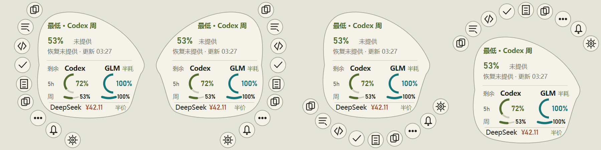

# codex-usage

## 直接让 Agent 帮你使用

把下面这段话复制给具备联网、文件读写和运行能力的 Agent。
它应先读本项目 [INSTALL.md](INSTALL.md)，完成提示词授权的下载、核验与使用步骤。
只想保存文件时，把“安装/运行”改成“只下载，不安装、不启动”。

```text
下载并运行 https://github.com/strive822/zyd-vibe-lab 里的 codex-usage。请先读取该项目 INSTALL.md，优先使用 Windows x64 便携包，核对 SHA-256 后完整解压并启动；保留配置，不代填密钥或开启自启动。
```

本地独立交付包：`delivery/codex-usage.zip`，校验文件：`delivery/SHA256SUMS.txt`。
直接下载：[独立项目 ZIP](https://raw.githubusercontent.com/strive822/zyd-vibe-lab/main/codex-usage/delivery/codex-usage.zip) · [SHA-256](https://raw.githubusercontent.com/strive822/zyd-vibe-lab/main/codex-usage/delivery/SHA256SUMS.txt) · [逐文件清单](https://raw.githubusercontent.com/strive822/zyd-vibe-lab/main/codex-usage/delivery/FILES.json)。
Agent 可下载独立 ZIP，或取得完整仓库后只使用本项目目录。

Windows 三平台额度浮窗，支持六位常用复制、更多文本和每日提醒。

## 启动

给 Agent 使用时先读 [下载与安装入口](INSTALL.md)，新机器默认下载已有便携包。

双击根目录 **launch.cmd**，启动当前便携版。E 盘副本和 GitHub 下载包见 [交付说明](docs/guides/USAGE.md)。源码运行使用 `src/run_app.py`。

## 目录

| 目录 | 内容 |
| --- | --- |
| `src/` | 生产源码、入口和视觉组件 |
| `tools/` | 检查、截图、性能、录屏和构建工具 |
| `tests/` | 自动测试 |
| `docs/` | 规格、设计、使用指南、历史记录和验收证据 |
| `packaging/` | 启动器、随包说明和构建缓存 |
| `dist/` | 当前可运行便携版 |
| `.venv-win/` | 本机 Windows 开发环境（不上传） |

用户数据统一在 `%USERPROFILE%\.usage`；密钥仍使用 Windows 凭据管理器。

## 开发与检查（Windows PowerShell）

```powershell
.\.venv-win\Scripts\python.exe src/run_app.py
.\.venv-win\Scripts\python.exe -m pytest
.\.venv-win\Scripts\python.exe -m mypy
.\.venv-win\Scripts\python.exe -m ruff check src tests tools
.\.venv-win\Scripts\python.exe tools/check_frozen_composition.py
.\.venv-win\Scripts\python.exe tools/build_portable.py
```

新机器创建环境及完整使用说明见 [使用指南](docs/guides/USAGE.md)。[文档索引](docs/README.md) · [工具索引](tools/README.md) · [清理记录](docs/history/CLEANUP.md)。

## 下载

[Windows x64 便携 ZIP](packages/usage-0.1.0-windows-x64.zip) · [SHA-256](packages/SHA256SUMS.txt)。完整解压后运行包内 `usage.exe`；首次克隆的开发环境按使用指南创建。



真实账户、私人文本和物理桌面录屏仅留本机，不公开。

## 内部文件规则

每处仅维护 `src/` 中的一份正式实现；`dist/` 只保留当前可运行生成包，不在包内修改代码。上传／下载ZIP在 `packages/` 保存；解压运行版只保留当前版本，其他维护副本不重复存ZIP。冻结源码是回归测试夹具，具有独立测试用途。重复截图／报告只保留一个实体文件，文档链接指向同一份；相同的冻结／当前渲染只输出一张图片，差异及双哈希保留在核验记录中。
