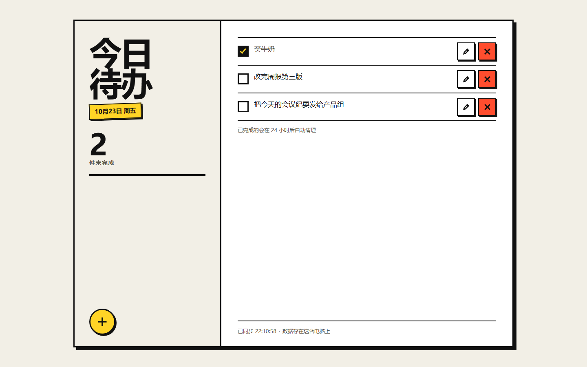
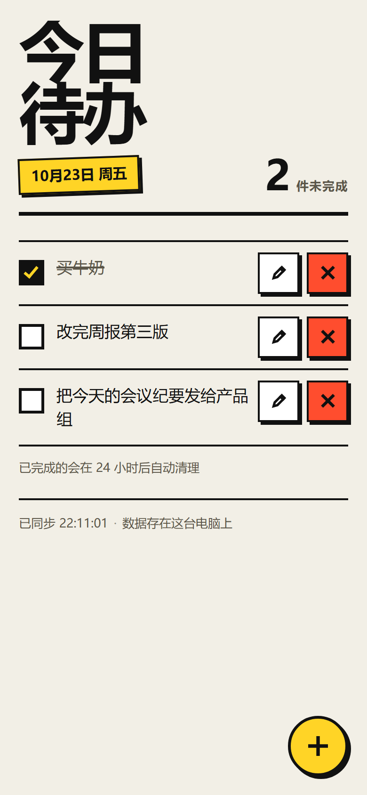
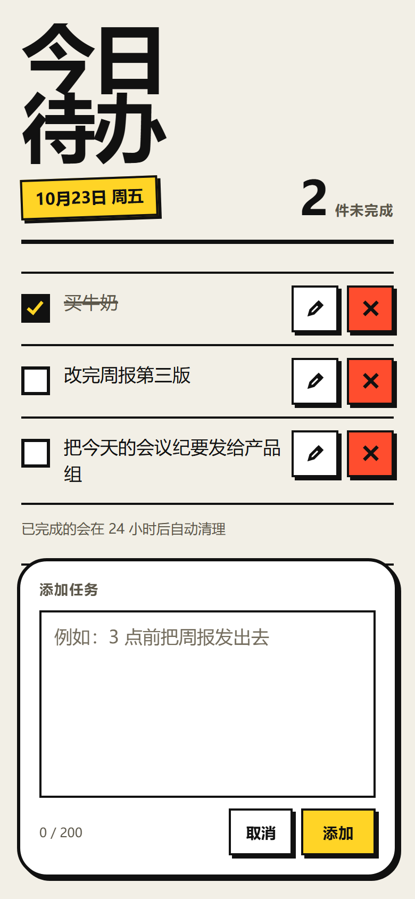

# 今日待办

## 直接让 Agent 帮你使用

把下面这段话复制给具备联网、文件读写和运行能力的 Agent。
它应先读本项目 [INSTALL.md](INSTALL.md)，完成下载、核验与启动。
只想保存文件时，把“启动”改成“只下载，不启动”。

```text
下载并运行 https://github.com/strive822/zyd-vibe-lab 里的 today-todo。请先读取该项目 INSTALL.md，把文件放进新目录并核验，再用 Node.js 启动本地服务、打开 http://localhost:3000 验证页面；不要覆盖已有的数据文件。
```

本地交付包：`delivery/today-todo.zip`，校验文件：`delivery/SHA256SUMS.txt`，逐文件清单：`delivery/FILES.json`。
这些文件由 `scripts/package_projects.py` 生成；首次推送后才能通过 raw 链接下载，未推送前请直接使用仓库目录。

> 一台电脑跑服务，手机连同一个 WiFi 打开同一份清单。零依赖、零构建，双击即用。

| 电脑端（FAB 停在板面底部） | 手机端（FAB 悬浮右下角） | 添加面板（同一容器形变） |
| --- | --- | --- |
|  |  |  |

## 是什么

一个只在本人电脑与手机之间使用的「今日待办」。电脑上跑一个 Node 本地服务，手机连同一 WiFi 打开同一份数据。
不联网、不注册、不上传云端；没有账号、没有云同步、没有第三方依赖。

技术上是一个 `node:http` 服务 + 三个静态文件，**不需要 `npm install`**。

## 功能

- 新增：点「+」→ 同一容器从 64×64 长成 470×300 面板（圆角 32→28，480ms，`cubic-bezier(.2,.9,.22,1)`），里面是**多行文本框**
- 勾选完成 / 取消完成；已完成 24 小时无再次操作自动清理
- 编辑：行内改文字，Enter 保存、Esc 取消
- 删除：立即执行，底部出现「撤销」
- 剩余计数实时更新；两台设备 3 秒内同步
- 断连时显示红色横幅并可重试

## 运行

Node.js 18 以上，Windows。双击 `start.bat` 会自动打开浏览器；或：

```bash
node server.js
```

终端会打印两个地址：`http://localhost:3000` 和手机用的局域网地址。端口被占用时自动回退 5 个端口。

## 数据

存在 `data/todos.json`（首次运行自动创建，不入库）。写入用临时文件 + rename 原子替换；文件损坏时自动备份为 `.corrupt-<时间戳>` 并以空清单启动。备份复制整个 `data/` 目录即可。

## 规则

- 空白任务（含全角空格）不会添加；单条最多 200 字
- 勾选完成的任务 24 小时内没有再操作会自动删除；期间取消勾选重新计时
- 清单不跨天清空 —— 未完成的事不会因为过了零点消失

## 目录

```
server.js             HTTP 服务：静态托管 + 4 个接口 + 局域网地址打印
start.bat             双击启动（UTF-8 控制台 + 自动开浏览器）
stop.bat              按端口结束服务
public/               index.html / style.css / app.js / favicon.svg
test/api.test.js      16 项接口、持久化、清理、路径穿越测试
tools/shot.js         真实设备尺寸截图 + 溢出测量（CDP）
tools/contrast.js     WCAG 对比度实测
tools/make-icon.js    从 favicon.svg 生成 assets/app.ico
assets/app.ico        图标（桌面快捷方式用）
SPEC.md               需求、范围、验收表
PLAN.md               阶段、决策记录、审查记录
DESIGN.md             视觉基线与动效规范
docs/VERIFY.md        照着点的人工验收清单
```

## 检查

```bash
node --test test/api.test.js      # 16 项
node tools/contrast.js            # 13 组对比度
```

不写文件、不连外网，可在任意目录执行。

## 已知限制

- 单用户、无密码：同一局域网内知道地址的人都能打开
- 只能在局域网用；换网络或电脑休眠后手机可能连不上
- 只支持单进程：不要对同一个 `data/todos.json` 同时跑两个服务（启动时会自动检测并拒绝第二个）
- 未在 iOS 真机与屏幕阅读器上验证（文本域已按 16px 防缩放，安全区已适配）
